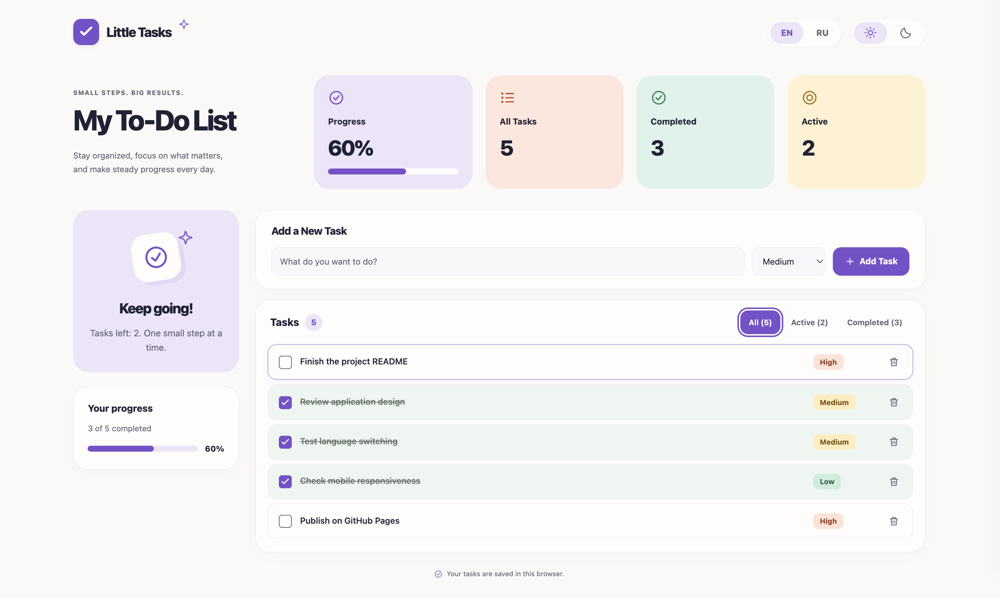

**[English](README.md)** | [Русский](README.ru.md)

# Little Tasks — To-Do List

A lightweight, responsive task manager with a playful Bento Dashboard, task priorities, and a fully bilingual interface.

Developed as a technical take-home assignment for a **Vibe Coder / AI-Assisted Developer** role. The project demonstrates an AI-assisted workflow, a simple architecture, and attention to usability without frameworks or external dependencies.

**Live demo:** https://aleksandr88p.github.io/todo-list/

## Preview



## Features

- **Task management:** add tasks with the button or Enter, mark them complete, undo completion, and delete individual tasks.
- **Persistent state:** tasks and completion status survive page reloads through localStorage.
- **Priorities:** choose High, Medium, or Low when adding a task. Medium is the default and is restored after each addition. Priority badges do not change task order.
- **Filters:** All, Active, and Completed, each with a task count. Filtering changes the view without modifying stored tasks; the initial filter after a reload is All.
- **Progress and statistics:** total, completed, and active task counts, a completion percentage, and progress bars. Statistics cover the entire list regardless of the selected filter; an empty list shows 0%.
- **English and Russian:** switch with EN / RU without reloading. English is the default on the first visit; the selected language is saved. Labels, errors, priority names, and accessibility labels are translated, and `html.lang` is updated. User task text and input drafts stay unchanged.
- **Light and dark themes:** the selected theme is saved; the system preference is used when there is no valid saved choice.
- **Responsive design:** solid pastel colors, rounded cards, local SVG icons, visible keyboard focus, and subtle transitions with `prefers-reduced-motion` support.

The scope deliberately excludes a backend, database, authentication, task editing, categories, and scheduling.

## Technology stack

| Technology | Purpose |
| --- | --- |
| HTML5 | Semantic page structure, forms, and native controls |
| CSS3 | Bento layout, responsive breakpoints, themes, and transitions |
| Vanilla JavaScript | Task state, DOM updates, filters, priorities, and translations |
| localStorage | Browser-local persistence for tasks and preferences |
| Inline SVG | Interface icons without external assets or icon libraries |

No package manager, dependency installation, or build step is required. Translations are maintained in a plain JavaScript object.

## Run locally

From the project root, start a static server with Python 3:

```sh
python3 -m http.server 8000 --bind 127.0.0.1
```

Open [http://127.0.0.1:8000](http://127.0.0.1:8000) in a modern browser. Stop the server with **Ctrl+C**.

You can also open `index.html` directly, but localStorage behavior for `file://` URLs varies between browsers. A local HTTP server is recommended for reproducible testing. Task IDs use `crypto.randomUUID()`, so use a modern browser on localhost or HTTPS.

## Data storage

All data stays in the current browser. There is no server, account, or cross-device synchronization. Clearing site data removes tasks and preferences. Different origins, including different hostnames or ports, have separate storage.

| localStorage key | Contents |
| --- | --- |
| `todo-list.tasks.v1` | JSON array of tasks |
| `todo-list.theme.v1` | `light` or `dark` |
| `todo-list.language.v1` | `en` or `ru` |

New task records use this shape:

```js
{ id: "uuid", title: "Review the project", completed: false, priority: "medium" }
```

The task storage key remains compatible with older records containing only `id`, `title`, and `completed`. A missing or unknown priority is displayed as Medium. Loading does not rewrite existing records; tasks are saved after task changes. Language and theme preferences are stored independently.

If task data is damaged, the app opens an empty list with an error message; the next successful task change replaces the damaged data. If storage is unavailable or full, actions continue in memory and a localized message explains the persistence failure. Task titles are rendered with `textContent`.

## AI-Assisted Development

**OpenAI Codex** assisted with implementation, styling, refactoring, documentation, and development checks. **ChatGPT** supported requirements analysis, planning, and refinement of the implementation requests.

The developer directs the process: defines and limits the requirements, selects the visual reference and design direction, reviews generated changes, performs manual acceptance testing, and makes the final quality decisions. AI assistance supports implementation; it does not replace developer ownership of the result.

## Testing

The following checks were performed during development:

- **Browser checks:** adding via button and Enter, completion and undo, deletion, filters, all three priorities, progress counters, and persistence after reloading. Both languages and themes were exercised; task text was preserved during language changes.
- **Responsive checks:** layouts at 320, 768, and 1440 px, including long task text, with no horizontal overflow in the tested cases. Empty input validation and rendering HTML-like task text as plain text were also checked. No errors were reported in the browser console during the checks.
- **Isolated JavaScript checks:** compatibility with older tasks, fallback for missing or unknown priorities, default priority reset, independent storage keys, translation consistency, empty-list progress, and simulated storage failures and recovery.
- **Static checks:** JavaScript syntax, HTML structure, SVG and label references, absence of gradients, the reduced-motion CSS rule, and selected text contrast pairs of at least 4.5:1.

These were development checks, not a committed automated test suite or a full accessibility audit. Physical mobile devices and OS-level reduced-motion behavior were not tested.

## Project structure

```text
.
├── index.html
├── styles.css
├── script.js
├── README.md
├── README.ru.md
└── screenshots/
    └── screenshot.png
```

The application consists of static files and can be hosted on GitHub Pages without a build step. The English `README.md` is the main repository documentation; the complete Russian version is available in [README.ru.md](README.ru.md).
