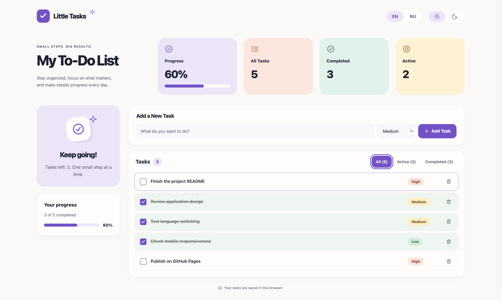

[English](README.md) | **[Русский](README.ru.md)**

# Little Tasks — To-Do List

Небольшой адаптивный менеджер задач с выразительным Bento Dashboard, приоритетами и полностью двуязычным интерфейсом.

Разработан как техническое тестовое задание для вакансии **Vibe Coder / AI-Assisted Developer**. Проект демонстрирует разработку с помощью ИИ, простую архитектуру и внимание к удобству использования без фреймворков и внешних зависимостей.

**Опубликованное приложение:** пока не опубликовано. Ссылка появится здесь после развёртывания.

## Скриншот



## Возможности

- **Управление задачами:** добавление кнопкой или Enter, отметка выполнения, её отмена и удаление отдельных задач.
- **Сохранение состояния:** задачи и отметки выполнения остаются после обновления страницы благодаря localStorage.
- **Приоритеты:** выбор High, Medium или Low — высокого, среднего или низкого приоритета — при добавлении задачи. По умолчанию выбран Medium; после каждого добавления выбор возвращается к нему. Бейджи приоритетов не меняют порядок задач.
- **Фильтры:** All, Active и Completed — «Все», «Активные» и «Завершённые», каждый со счётчиком задач. Фильтрация меняет отображение, не изменяя сохранённые задачи; после обновления выбран All.
- **Прогресс и статистика:** общее количество задач, количество завершённых и активных, процент выполнения и прогресс-бары. Статистика учитывает весь список независимо от фильтра; пустой список показывает 0%.
- **Английский и русский:** переключение EN / RU без перезагрузки. При первом посещении выбран английский; выбор языка сохраняется. Переводятся подписи, ошибки, названия приоритетов и accessibility labels; обновляется `html.lang`. Тексты пользовательских задач и черновик в поле ввода не меняются.
- **Светлая и тёмная темы:** выбор сохраняется; при отсутствии корректной сохранённой настройки используется системная тема.
- **Адаптивный дизайн:** однотонные пастельные цвета, скруглённые карточки, локальные SVG-иконки, видимый фокус клавиатуры и ненавязчивые переходы с поддержкой `prefers-reduced-motion`.

В проект намеренно не входят backend, база данных, авторизация, редактирование задач, категории и планирование по датам.

## Технологический стек

| Технология | Назначение |
| --- | --- |
| HTML5 | Семантическая структура страницы, формы и нативные элементы управления |
| CSS3 | Bento-сетка, адаптивные стили, темы и переходы |
| JavaScript без фреймворков | Состояние задач, обновление DOM, фильтры, приоритеты и переводы |
| localStorage | Хранение задач и настроек в браузере |
| Inline SVG | Иконки интерфейса без внешних ресурсов и библиотек иконок |

Пакетный менеджер, установка зависимостей и сборка не требуются. Переводы хранятся в обычном объекте JavaScript.

## Локальный запуск

Из корневой папки проекта запустите статический сервер с помощью Python 3:

```sh
python3 -m http.server 8000 --bind 127.0.0.1
```

Откройте [http://127.0.0.1:8000](http://127.0.0.1:8000) в современном браузере. Для остановки сервера нажмите **Ctrl+C**.

Можно также открыть `index.html` напрямую, но поведение localStorage для адресов `file://` зависит от браузера. Для воспроизводимой проверки рекомендуется локальный HTTP-сервер. Идентификаторы задач создаются через `crypto.randomUUID()`, поэтому используйте современный браузер и localhost либо HTTPS.

## Хранение данных

Все данные остаются в текущем браузере. Сервера, учётной записи и синхронизации между устройствами нет. Очистка данных сайта удаляет задачи и настройки. У разных origin, включая разные имена хостов или порты, отдельные хранилища.

| Ключ localStorage | Содержимое |
| --- | --- |
| `todo-list.tasks.v1` | Массив задач в JSON |
| `todo-list.theme.v1` | `light` или `dark` |
| `todo-list.language.v1` | `en` или `ru` |

Новые задачи имеют следующий формат:

```js
{ id: "uuid", title: "Review the project", completed: false, priority: "medium" }
```

Ключ хранения задач остаётся совместимым со старыми записями, содержащими только `id`, `title` и `completed`. Отсутствующий или неизвестный приоритет отображается как Medium. Загрузка не переписывает существующие записи; сохранение выполняется после изменения задач. Настройки языка и темы хранятся независимо.

Если данные задач повреждены, приложение открывает пустой список с сообщением об ошибке; следующее успешное изменение задач заменяет повреждённые данные. Если хранилище недоступно или переполнено, действия продолжают работать в памяти, а локализованное сообщение объясняет ошибку сохранения. Названия задач выводятся через `textContent`.

## Разработка с помощью ИИ — AI-Assisted Development

**OpenAI Codex** помогал с реализацией, оформлением, рефакторингом, документацией и проверками в процессе разработки. **ChatGPT** использовался для анализа требований, планирования и уточнения запросов на реализацию.

Разработчик управляет процессом: формулирует и ограничивает требования, выбирает визуальный референс и направление дизайна, проверяет сгенерированные изменения, проводит ручное приёмочное тестирование и принимает окончательные решения о качестве. Помощь ИИ поддерживает реализацию, сохраняя ответственность за результат за разработчиком.

## Тестирование — Testing

В процессе разработки были выполнены следующие проверки:

- **В браузере:** добавление кнопкой и Enter, выполнение и отмена, удаление, фильтры, все три приоритета, счётчики прогресса и сохранение после обновления. Проверены оба языка и обе темы; тексты задач сохранялись при переключении языка.
- **Адаптивность:** интерфейс на ширинах 320, 768 и 1440 px, включая длинные названия задач; в проверенных сценариях горизонтального переполнения не было. Также проверены валидация пустого ввода и отображение текста, похожего на HTML, как обычной строки. Во время проверок ошибок в консоли браузера не зафиксировано.
- **Изолированные проверки JavaScript:** совместимость со старыми задачами, подстановка среднего приоритета при отсутствующем или неизвестном значении, сброс выбора приоритета, независимость ключей хранения, согласованность переводов, прогресс пустого списка, имитация ошибок хранилища и восстановление после них.
- **Статические проверки:** синтаксис JavaScript, структура HTML, ссылки на SVG и подписи элементов, отсутствие градиентов, CSS-правило уменьшения движения и контраст выбранных пар текста и фона не ниже 4,5:1.

Это проверки в процессе разработки, а не включённый в репозиторий набор автоматических тестов или полный аудит доступности. Физические мобильные устройства и поведение при системном уменьшении движения не проверялись.

## Структура проекта

```text
.
├── index.html
├── styles.css
├── script.js
├── README.md
├── README.ru.md
└── screenshots/
    └── screenshot.png
```

Приложение состоит из статических файлов и может размещаться на GitHub Pages без сборки. Основная документация репозитория — английский `README.md`; она доступна в [README.md](README.md). Этот файл содержит её полный русский перевод.
